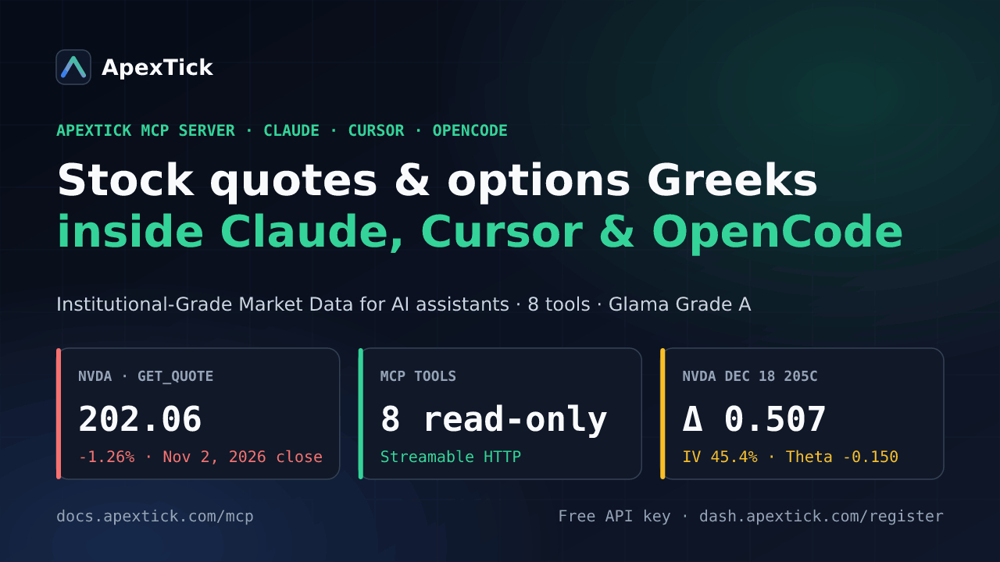
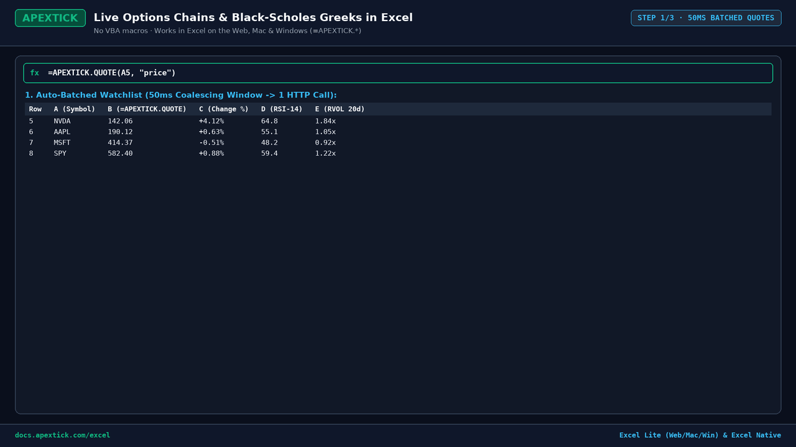

# ApexTick MCP Server (`@apextick/mcp-server`)

[](https://glama.ai/mcp/servers/apextick/apextick-starter-kit)
[](https://mcprush.com/to/apextick-market-data-options-mcp?ref=badge)

Official Model Context Protocol (MCP) server for **[ApexTick](https://apextick.com)** (`https://docs.apextick.com/mcp`), built on `@modelcontextprotocol/sdk`.

Provides AI agents (Claude Desktop, Claude Code, Cursor, Windsurf, OpenCode) with low-latency access to **66,400+ global equities, ETFs, FX pairs, and cryptocurrencies**, valuation multiples, technical indicators (`RSI14`, `MACD`, `SMA20/50/200`, `ATR14`, `volatility30`), earnings surprise context, GICS sector movers, and options implied volatility screening.



## Tools Implemented (`src/index.mjs`)

1. **`get_quote`** *(Hobbyist $0+)*: Consolidated quote for one ticker (price, change, % change, 52-week range, abbreviated volume, and timestamp).
2. **`search_tickers`** *(Hobbyist $0+)*: Symbol and instrument directory search across 66,400+ global equities, ETFs, FX pairs, indices, and cryptocurrencies.
3. **`get_watchlist_brief`** *(Hobbyist $0+)*: Batched quote table for up to 20 symbols in a single request.
4. **`get_price_history`** *(Hobbyist $0+)*: Historical OHLCV bars (`1m` to `1mo`) and optional corporate event calendar (earnings surprises, dividend ex-dates, and stock splits on Trader Pro+).
5. **`analyze_ticker`** *(Trader Pro+)*: Concurrent quote + fundamentals snapshot (session range position, gap %, distance from 52-week high, and P/E, P/B, P/S, TTM Revenue, EPS, ROE, dividend yield).
6. **`explain_price_move`** *(Trader Pro+)*: Correlates session price move with technical indicators (`RSI14`, `SMA20/50/200`, `MACD`, `ATR14`) and recent/upcoming earnings surprises.
7. **`get_options_chain`** *(Trader Pro+)*: Option chain, expiration dates, and Black-Scholes Greeks (`delta`, `gamma`, `theta`, `vega`, `rho`) lookup for an underlying ticker.
8. **`screen_market`** *(Quant & Community+)*: Cross-market discovery screener returning top gainers, losers, volume leaders (with optional GICS `sector` and `min_market_cap` filters), and liquid high-IV options underlyings.

## Usage

### Option 1: Local Stdio Server (`src/index.mjs` or Docker)

```json
{
  "mcpServers": {
    "apextick": {
      "command": "node",
      "args": ["/path/to/apextick-starter-kit/src/index.mjs"],
      "env": {
        "APEXTICK_API_KEY": "dk_your_key_here"
      }
    }
  }
}
```

### Option 2: Hosted Streamable HTTP Endpoint (`https://api.apextick.com/mcp`)

```json
{
  "mcpServers": {
    "apextick": {
      "url": "https://api.apextick.com/mcp",
      "headers": {
        "apikey": "dk_your_key_here"
      }
    }
  }
}
```

## Ready-to-Use Excel Workbooks (`excel/`) & REST Quickstarts



All 4 workbooks work natively in both **ApexTick Excel Lite** (`excel.office.com`, Mac, Windows) and **ApexTick Excel Native** (Windows desktop):

* **[`excel/ApexTick-Starter-and-Test-Suite.xlsx`](./excel/ApexTick-Starter-and-Test-Suite.xlsx)** — Complete 6-tab dynamic-array test suite covering all 17 `=APEXTICK.*` worksheet functions (`=APEXTICK.QUOTE`, `=APEXTICK.STREAM`, `=APEXTICK.OPTIONS.CHAIN`, `=APEXTICK.FINANCIALS`, `=APEXTICK.ECO`).
* **[`excel/Covered-Call-Wheel-Tracker.xlsx`](./excel/Covered-Call-Wheel-Tracker.xlsx)** — Covered call & cash-secured put wheel tracker with 50ms batched quotes, technical regime indicators (`RSI14`, `volatility30`, `ATR14`), and liquid options screener (`=APEXTICK.OPTIONS.SCREENER`).
* **[`excel/Options-IV-Greeks-Calculator.xlsx`](./excel/Options-IV-Greeks-Calculator.xlsx)** — Side-by-side Call & Put options chain analyzer (`=APEXTICK.OPTIONS.CHAIN`) with analytical Black-Scholes Greeks (`Delta`, `Gamma`, `Theta`, `Vega`, `Implied Volatility`).
* **[`excel/SP500-Tech-Watchlist-Valuation.xlsx`](./excel/SP500-Tech-Watchlist-Valuation.xlsx)** — 20-symbol S&P 500 & Nasdaq-100 valuation and momentum watchlist (`P/E`, `Sector`, `RSI14`, `SMA200`, `=APEXTICK.FINANCIALS`, `=APEXTICK.ETF.HOLDINGS`).
* `examples/python/quickstart.py` & `examples/javascript/quickstart.mjs` — Direct REST API examples.

## API Key

Get a free Hobbyist API key (500 requests/day, no credit card required) at **[https://dash.apextick.com/register](https://dash.apextick.com/register)**.
